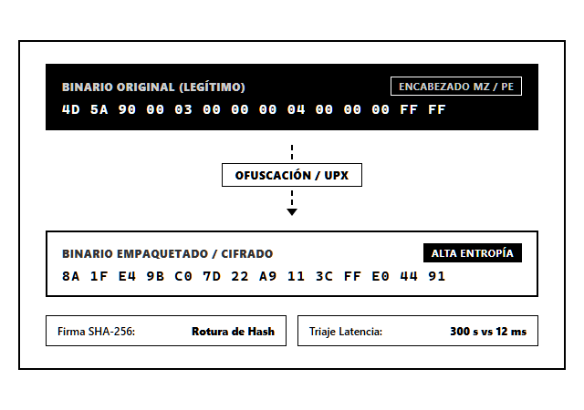
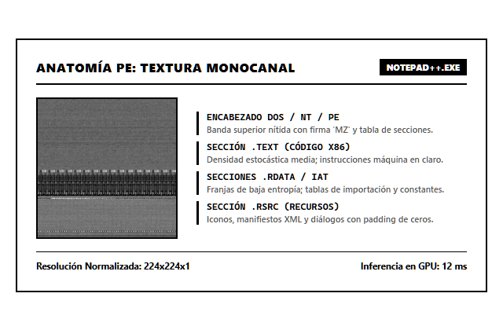
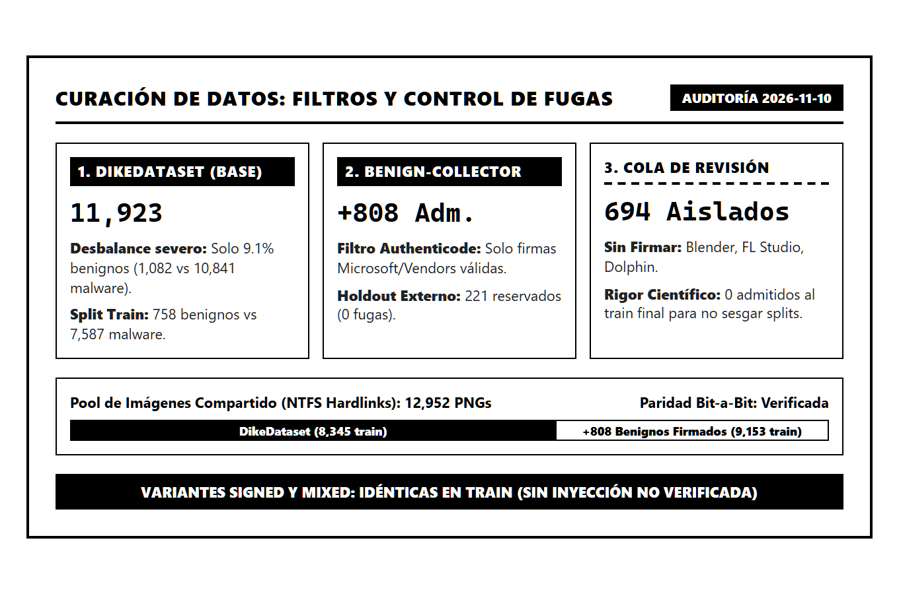
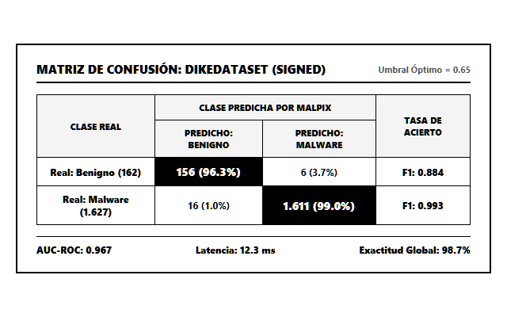
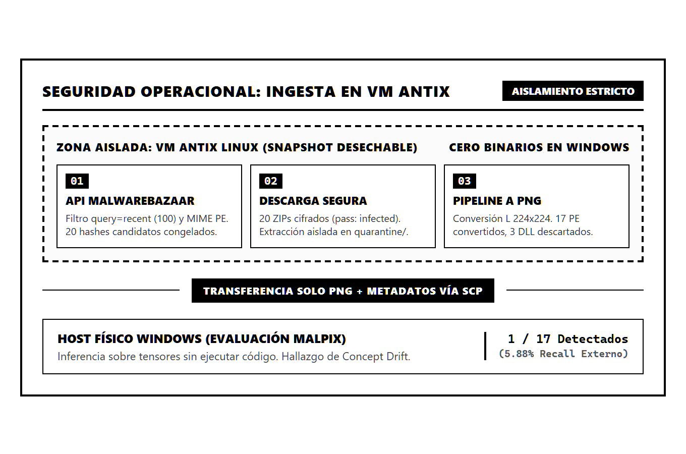
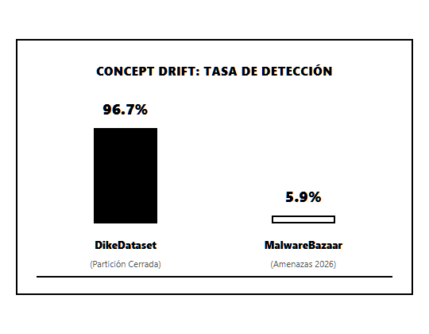

# MalPix 🛡️

> **High-Throughput Static PE Malware Triage via Byte-Texture Analysis & Deep Learning**  
> *Detección y Clasificación de Malware en Binarios PE de Windows mediante Texturas de Bytes con Redes Neuronales Convolucionales*

[](https://www.python.org/)
[](https://pytorch.org/)
[](tests/)
[](LICENSE)
[](#-experimental-results)
[](#-key-highlights)
[](https://youtu.be/WVeYZ8L3QAA)

---

## 📌 Key Highlights

- 🎥 **Oral Defense & Live Walkthrough:** Complete 15-minute recorded academic defense available on [YouTube](https://youtu.be/WVeYZ8L3QAA).
- ⚡ **12.3 ms Inference Latency:** High-speed static triage on consumer GPUs (NVIDIA RTX 3060) without disassembly or sandbox overhead.
- 🛡️ **Zero Execution Risk:** Binaries are parsed as passive 2D byte matrices—eliminating dynamic detonation hazards in corporate gateways.
- 📐 **Adapted Single-Channel ResNet-18:** ImageNet-pretrained kernels algebraically collapsed into a single grayscale channel to retain spatial edge detectors.
- 🔍 **Rigorous Provenance & Safety Gates:** Audited and rejected MaleVis due to 7 hidden Trojans discovered via CIRCL hashlookup; curated DikeDataset with Microsoft Authenticode digital signatures.
- ⚠️ **Empirical Concept Drift Revelation:** Tested against 17 fresh, active MalwareBazaar threats (Nov 10, 2026) in an isolated antiX Linux VM, proving how temporal shift degrades static vision models (5.88% recall).

---

## 🎯 Problem Statement & Threat Landscape

Modern malware ecosystems record over **450,000 new malicious variants per day**. Adversaries rarely deliver uncompressed binaries; they employ dynamic runtime packers (UPX, Themida) and polymorphic encryption routines that completely mutate the physical byte sequence without altering runtime payload intent.



### Why Conventional Defenses Fail
1. **Cryptographic Signatures (MD5 / SHA-256):** 0% resilience against polymorphism. Changing a single padding byte invalidates the hash.
2. **Static Disassembly (IDA Pro / Ghidra):** Fails catastrophically against packed or encrypted sections, generating corrupted intermediate code.
3. **Dynamic Sandbox Detonation:** Demands 3 to 5 minutes per specimen—creating an unsustainable bottleneck for real-time corporate perimeter filtering.

---

## 🏗️ Visual Representation: The Nataraj Method

MalPix converts raw binary streams into 2D single-channel grayscale textures following the spatial mapping standard introduced by Nataraj et al. (2011):

```
Raw Windows PE Binary (bytes 0x00 to 0xFF)
                 │
                 ▼
Adaptive Grid Formatting (256-byte row width, zero-padded final row)
                 │
                 ▼
Bilinear Resampling to Fixed Resolution (224 × 224, Mode L Grayscale)
                 │
                 ▼
Min-Max Normalization to Tensor (PyTorch Float32 [1, 224, 224], normalized to [-1, 1])
                 │
                 ▼
Single-Channel ResNet-18 Classifier -> [Benign (0), Malware (1)]
```



Structural Portable Executable (PE) headers, `.text` machine code sections, `.rdata` import tables, and resource segments generate distinct spatial entropy patterns that convolutional networks learn to classify without executing code.

---

## 🧪 Dataset Engineering & Curation Odyssey



### 1. Rejecting the MaleVis Dataset
While MaleVis claims >98% accuracy in academic literature, our CIRCL hashlookup audit revealed **7 active *KnownMalicious* Trojans masquerading as benign** in its "Other" class. Furthermore, the official Windows `winver.exe` was misclassified as an *Androm* Trojan. MaleVis was discarded entirely to eliminate label noise.

### 2. DikeDataset Imbalance & `benign-collector`
DikeDataset (11,923 files) exhibits real-world telemetry imbalance: **only 9.1% benign** (1,082 benign vs 10,841 malware). To bolster clean representations without contaminating evaluation partitions:
- Developed `benign-collector`, harvesting system binaries filtered strictly via **Windows Authenticode digital signatures** (`WinVerifyTrust`).
- Admitted **808 verified signed binaries** to the training split.
- Reserved **221 signed binaries** into a family-isolated external holdout (`external_benign`).
- Quarantined **694 unsigned candidates** (Blender, PostgreSQL, MinGW/Git tools) with 0 admitted to training, preserving zero-leakage splits.

---

## 📊 Experimental Results

Evaluated on the frozen, stratified DikeDataset test partition (1,789 images: 162 benign, 1,627 malware) and external holdouts:

| Configuration | Benign Train | Malware Train | Validation Threshold | Dike Macro-F1 | Dike Balanced Accuracy | External Benign FPR (n=221) |
| :--- | :---: | :---: | :---: | :---: | :---: | :---: |
| **Original** | 758 | 7,587 | 0.94 | **0.9689** | **0.9858** | 3.62% (8 / 221) |
| **Signed** | 1,566 | 7,587 | 0.65 | 0.9637 | 0.9766 | 2.26% (5 / 221) |
| **Mixed** | 1,566 | 7,587 | 0.86 | 0.9550 | 0.9803 | **0.90% (2 / 221)** |



---

## ☣️ Operational Security & Live Concept Drift Evaluation

To test out-of-distribution generalization against live threats, 17 fresh, active malware specimens were acquired from **MalwareBazaar** ([abuse.ch](https://abuse.ch)) on November 10, 2026.



### Strict Airgap Isolation
- All raw handling, archive decryption (password: `infected`), and byte-to-PNG conversion executed inside an **isolated antiX Linux virtual machine** with a disposable snapshot.
- Only 224×224 mode L PNG images and non-executable metadata were transferred to Windows via SCP. **Zero executable malware touched the host.**

### Concept Drift Collapse (TESSERACT Framework)
When tested on these contemporary threats, detection crashed from **96.7% down to 5.88% (1 / 17 detected)**.



As demonstrated by Pendlebury et al. (TESSERACT), CNNs trained on byte textures memorize historical packing signatures (2019-2020) rather than intrinsic semantic maliciousness. When attackers adopt new compilation toolchains, spatial texture models face severe temporal concept drift.

---

## 🚀 Quickstart & Reproducibility

### Prerequisites
- Python 3.10+ (tested up to 3.14)
- PyTorch 2.x with CUDA 12+ (tested on NVIDIA RTX 3060)

### 1. Installation
```powershell
git clone https://github.com/tronprogram/malpix.git
cd malpix
python -m venv .venv
.\.venv\Scripts\Activate.ps1
pip install -r requirements.txt
```

### 2. Validation & Quality Assurance
```powershell
python -m unittest discover -s tests -v
```

### 3. Pipeline CLI Execution
```powershell
# Validate dataset splits and image stores
python -m app.main validate-dataset

# Train model configurations
python -m app.main train --config original
python -m app.main train --config signed
python -m app.main train --config mixed

# Evaluate on test partition and external holdout
python -m app.main evaluate --config signed --external

# Perform single-image inference
python -m app.main infer --config signed sample.png
```

---

## 📁 Repository Structure

```
malpix/
├── app/
│   ├── config.py       # Configuration schemas & hyperparameters
│   ├── data.py         # Grayscale PyTorch transforms & data loaders
│   ├── dataset.py      # Split partitioning, validation & parity assertions
│   ├── evaluate.py     # Evaluation routines & confusion matrix generation
│   ├── inference.py    # Single-image forward pass & scoring
│   ├── main.py         # Typer CLI application entry point
│   ├── model.py        # Single-channel ResNet-18 builder
│   └── train.py        # Class-weighted AdamW training & Cosine Annealing loop
├── assets/             # Architecture, curation & evaluation diagrams
├── tests/
│   └── test_malpix_layout.py # Automated unit tests for dataset layout & tensor contracts
├── pyrightconfig.json  # Static type checker configuration
├── requirements.txt    # Python package dependencies
├── LICENSE             # MIT License
└── README.md
```

---

## 👤 Author & Maintainer

- **Maintainer:** [tronprogram](https://github.com/tronprogram)
- **Project:** MalPix — Edge Deep Learning for PE Malware Classification
- **Date:** November 2026

---

## 📜 License

This project is licensed under the MIT License — see the [LICENSE](LICENSE) file for details.
